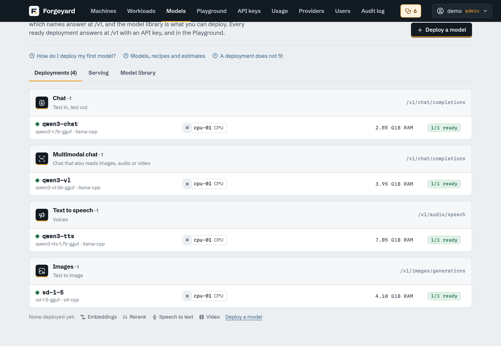

# Forgeyard

[](LICENSE)
[](https://github.com/xianhong1208/forgeyard/actions/workflows/ci.yml?query=branch%3Adev)
[](https://github.com/xianhong1208/forgeyard/releases/latest)
[](https://hub.docker.com/r/tonyhuang1101/forgeyard)

Run AI models on your own NVIDIA, AMD and CPU machines, behind one OpenAI-compatible API.

An agent on each machine reports its hardware. You deploy models from a catalog, Forgeyard places
them where they fit, and every program calls them at `/v1` with an API key.

**[Guide](docs/guide/README.md)** · **[繁體中文](README.zh-TW.md)** · **[Roadmap](ROADMAP.md)** ·
**[Changelog](CHANGELOG.md)**



## ✨ Key features

- **One control plane for NVIDIA, AMD and CPU machines.** Each machine runs model replicas, services
  and tasks on the cards you allow; AMD cards run ROCm or Vulkan builds. Each machine's page maps
  every card's memory to the deployments and workloads that hold it.
- **Memory estimates before you deploy.** Forgeyard reads a model's details without downloading it,
  shows the memory one copy needs and where it fits, and lets small models share a GPU.
- **An OpenAI-compatible gateway.** Every deployment answers at `/v1`, with API keys, per-key limits,
  usage and cost per key, model and person (charted by day, week and month), and failover between
  replicas.
- **Local first, cloud when needed.** A request spills to OpenAI, Anthropic, Gemini, Azure or
  OpenRouter only when local replicas are busy or down, only for keys allowed to, within monthly
  budgets.
- **More than chat.** Images, audio and video in chat, embeddings and rerank, speech to text, text to
  speech, image generation, and video generation as jobs.
- **Any HTTP service behind the same keys.** A workload's API at `/x/<name>/…` gets keys, limits and
  usage, and templates start object detection, segmentation and depth APIs in one step.
- **HTTPS out of the box.** The server makes its own certificate authority, agents pin its
  fingerprint when they join, and stored secrets are encrypted.
- **Machines without internet.** Engine images carried over as files run the built-in recipes as
  they are; the agent checks a loaded image against the pinned one before it runs it. Placement
  prefers machines that already have the model and engine, avoids one that could not reach Hugging
  Face, GitHub or a registry, and moves a replica stuck on such a download to a machine that can.

## What's new in 1.3

1.3 adds images, audio and video in chat, text to speech, image and video generation, workloads at
`/x/` with vision templates, and the server and agent images on Docker Hub. 1.3.1 lets you change a
deployment in place; 1.3.2 and 1.3.3 are fixes. Every change is in the
[CHANGELOG](CHANGELOG.md).

## 🚀 Installation

### The server

It needs no GPU. With Docker (linux/amd64 and linux/arm64, nothing to build):

```bash
sudo docker run -d --name forgeyard --restart always --hostname forgeyard \
  -p 7860:7860 \
  -v forgeyard-data:/data \
  -e PUBLIC_URL=https://192.168.1.20:7860 \
  docker.io/tonyhuang1101/forgeyard:1.3.3
sudo docker logs forgeyard
```

Or from source, with [uv](https://docs.astral.sh/uv/) (it gets Python 3.13) and Node 22.12 or newer
to build the web UI:

```bash
git clone https://github.com/xianhong1208/forgeyard.git
cd forgeyard
cd web && npm ci && npm run build && cd ..
uv sync
HOST=0.0.0.0 PUBLIC_URL=https://192.168.1.20:7860 uv run python main.py
```

Use your server's address instead of `192.168.1.20`. The log shows a one-time setup token for
`https://192.168.1.20:7860/setup`. The server speaks HTTPS from its own certificate authority and
keeps everything in `data/` (in Docker, the `forgeyard-data` volume). The clone gets the latest
release; `git checkout dev` gives what is not released yet.

### An agent, on each machine that runs models

**Machines → Add a machine** writes the command. The one-line install checks the server's CA
against its fingerprint, then installs the agent of the server's version as a systemd service:

```bash
curl -fsSk https://192.168.1.20:7860/api/tls/ca.pem -o forgeyard-ca.pem && \
  sed '/-----/d' forgeyard-ca.pem | base64 -d > forgeyard-ca.der && \
  echo "3f9a…  forgeyard-ca.der" | sha256sum -c && \
  curl -fsS --cacert forgeyard-ca.pem https://192.168.1.20:7860/install.sh | \
  sudo sh -s -- --join fyj_… --ca-fingerprint sha256:3f9a…
```

Or the agent image, from the **Docker** tab. On an NVIDIA machine it looks like this:

```bash
sudo docker run -d --name forgeyard-agent --restart always --network host \
  --gpus all \
  -v /var/run/docker.sock:/var/run/docker.sock \
  -v forgeyard-agent:/var/lib/forgeyard-agent \
  -v /srv/forgeyard-models:/srv/forgeyard-models \
  -e FORGEYARD_SERVER=https://192.168.1.20:7860 \
  -e FORGEYARD_CA_FINGERPRINT=sha256:3f9a… \
  -e FORGEYARD_JOIN_TOKEN=fyj_… \
  -e FORGEYARD_MODEL_CACHE=/srv/forgeyard-models \
  docker.io/tonyhuang1101/forgeyard-agent:1.3.3
```

The join token works once, within 15 minutes. AMD and CPU-only machines:
[Add an AMD machine](docs/guide/how-to.md#add-an-amd-machine),
[Add a CPU-only machine](docs/guide/how-to.md#add-a-cpu-only-machine),
[Run the agent in Docker](docs/guide/how-to.md#run-the-agent-in-docker).

## Quick start

1. Open `https://192.168.1.20:7860/setup`, enter the setup token and create the owner. Then open
   **Trust this server** and install the CA on your device.
2. **Machines → Add a machine**, and run the command on the machine. It shows up within seconds.
3. **Models → Model library → Add a model**, pick a recommended model (for a CPU:
   *Qwen3 1.7B (GGUF, for the CPU)*), then **Deploy it** with the name `qwen`.
4. **API keys → New key**. On the computer that calls the model, get the CA file and the SDK:

   ```bash
   export FORGEYARD_API_KEY=fyk_…
   curl -fsSk https://192.168.1.20:7860/api/tls/ca.pem -o forgeyard-ca.pem
   pip install openai
   ```

5. Call it with the official OpenAI SDK:

   ```python
   import os
   import ssl

   from openai import DefaultHttpxClient, OpenAI

   ca = ssl.create_default_context(cafile="forgeyard-ca.pem")
   client = OpenAI(base_url="https://192.168.1.20:7860/v1", api_key=os.environ["FORGEYARD_API_KEY"],
                   http_client=DefaultHttpxClient(verify=ca))
   reply = client.chat.completions.create(
       model="qwen",
       messages=[{"role": "user", "content": "Say hello in five words. /no_think"}],
       max_tokens=100,
   )
   print(reply.choices[0].message.content)
   ```

The [quick start in the guide](docs/guide/quick-start.md) goes through each step, with what it
prints and how to check the CA's fingerprint.

## Deployment options

| Option | How |
|---|---|
| **Docker** | The server and the agent are on Docker Hub as `tonyhuang1101/forgeyard` and `tonyhuang1101/forgeyard-agent`, one tag per release: [Run the server in Docker](docs/guide/how-to.md#run-the-server-in-docker), [Run the agent in Docker](docs/guide/how-to.md#run-the-agent-in-docker) |
| **systemd** | The one-line install sets up the agent as the service `forgeyard-agent`. The server from source runs as a service too: [Run the server as a service](docs/guide/how-to.md#run-the-server-as-a-service) |
| **Behind a reverse proxy** | nginx or Caddy handles HTTPS, and the server runs with `TLS=off` on `127.0.0.1`: [Use your own certificate or a reverse proxy](docs/guide/how-to.md#use-your-own-certificate-or-a-reverse-proxy) |

Upgrades, backups and moving a model cache: [How-to](docs/guide/how-to.md#upgrade-the-server-and-the-agents).

## 📚 Documentation

The **[guide](docs/guide/README.md)** ([繁體中文](docs/guide/zh-TW/README.md)) is also served by
Forgeyard itself at `/guide`:

| Page | What it covers |
|---|---|
| [Quick start](docs/guide/quick-start.md) | from nothing to your first `/v1` call in about ten minutes |
| [Concepts](docs/guide/concepts.md) | machines and agents, GPU access, workloads, models, deployments and the gateway, keys, roles |
| [How-to](docs/guide/how-to.md) | AMD and CPU-only machines, the server and the agent in Docker, shared GPUs, your own certificate, upgrades, backups |
| [Cloud providers](docs/guide/cloud-providers.md) | OpenAI, Anthropic, Gemini, Azure, OpenRouter or your own server behind `/v1`; when a request spills; which keys may use the cloud |
| [Troubleshooting](docs/guide/troubleshooting.md) | problems seen on real machines, with their fix |
| [Reference](docs/guide/reference.md) | every server and agent setting, the command line, files and ports |

Also:

- [Design notes](docs/design.md): how each part works, in detail.
- [HTTPS and trust](docs/https-and-trust.md): the certificate authority, agents' fingerprints,
  stored secrets, and
  [upgrading agents that joined 1.0 over plain HTTP](docs/https-and-trust.md#upgrading-from-10-agents-that-joined-over-plain-http).
- [Development](docs/development.md): build, test, and find your way around the code.

## Tested on

Every release is checked on real machines, not only in CI. So far:

| Hardware | Software | What ran |
|---|---|---|
| NVIDIA A100 80GB PCIe (an 8-GPU host, with a GPU allowlist) | driver 580, CUDA 13.0, Docker | joining and the GPU allowlist; services and tasks as processes and containers, each seeing only its card; vLLM 0.32 (Qwen3-4B chat, Qwen3 embedding and reranker, images and video in chat with Qwen3-VL-2B, audio in chat with Gemma 4 12B), speaches 0.8.3 (faster-whisper), vLLM-Omni (Qwen3-TTS text to speech, Stable Diffusion XL and Z-Image-Turbo image generation, Wan2.1 video generation), llama.cpp 1.0.0's CUDA build (images, audio and video in chat with Qwen3-VL-2B and Qwen2.5-Omni-3B GGUF, text to speech with Qwen3-TTS 1.7B and Chatterbox Turbo GGUF); the gateway with the official OpenAI SDK; the agent from its container image |
| AMD Ryzen AI MAX+ 395 with Radeon 8060S (Strix Halo, gfx1151 APU, 96 GiB carve-out) | Ubuntu 24.04, ROCm 7.0.2, amd-smi 26.0.2 | the inventory through the `amdsmi` library (unified memory), joining, and Qwen3-1.7B GGUF on llama.cpp's Vulkan build (accepted on b12242) served through `/v1`, on a machine that could reach neither Hugging Face nor `ghcr.io`; on llama.cpp 1.0.0's Vulkan build, offline too, images, audio and video in chat (Qwen3-VL-2B and Qwen2.5-Omni-3B GGUF) and text to speech (Qwen3-TTS 1.7B and Chatterbox Turbo GGUF); image generation with stable-diffusion.cpp's Vulkan build (Z-Image-Turbo GGUF), its image loaded from a file |
| x86-64 without a GPU | Linux | llama.cpp 1.0.0 as a process (Qwen3-1.7B GGUF) on two agents at once: balancing, failover when one engine dies; images, audio and video in chat with llama.cpp (Qwen3-VL-2B and Qwen2.5-Omni-3B GGUF); text to speech with llama.cpp 1.0.0 (Qwen3-TTS 1.7B GGUF in Chinese and English, Chatterbox Turbo) and speaches (Kokoro 82M), the speech checked by faster-whisper; image generation with stable-diffusion.cpp as a process (Stable Diffusion 1.5 and Z-Image-Turbo GGUF) |
| Google Gemini (`gemini-2.5-flash`) | its OpenAI-compatible endpoint | spilling when a request is too long for the local model, streaming, cost (thinking tokens included) and budgets |

Not checked on real hardware yet: the ROCm images of the `vllm` and `llama-cpp` recipes, discrete AMD
cards, the one-line install on a host
with systemd, and Wan2.2-TI2V-5B video. Video generation is checked with vLLM-Omni (Wan2.1-T2V-1.3B, 832x480 for 5 s, on the A100). Image generation on NVIDIA is checked with vLLM-Omni (Stable Diffusion XL and Z-Image-Turbo on the A100)
and with stable-diffusion.cpp's CUDA build (Stable Diffusion 1.5 and Z-Image-Turbo GGUF on the A100). Reports from other machines are welcome (see
[CONTRIBUTING.md](CONTRIBUTING.md)).

### Models tested

| Model | Engine (recipe) | Hardware |
|---|---|---|
| **Chat** | | |
| Qwen3-4B | vLLM 0.32 (`vllm`) | NVIDIA A100 |
| Qwen3-1.7B GGUF | llama.cpp (`llama-cpp`) | CPU (1.0.0); AMD Strix Halo (Vulkan, accepted on b12242) |
| **Multimodal chat** | | |
| Qwen3-VL-2B Instruct: image, video | vLLM (`vllm`) | NVIDIA A100 |
| Gemma 4 12B: audio | vLLM (`vllm`) | NVIDIA A100 |
| Qwen3-VL-2B GGUF: image, video | llama.cpp 1.0.0 (`llama-cpp`) | CPU; NVIDIA A100 (CUDA); AMD Strix Halo (Vulkan) |
| Qwen2.5-Omni-3B GGUF: image, audio, video | llama.cpp 1.0.0 (`llama-cpp`) | CPU; NVIDIA A100 (CUDA); AMD Strix Halo (Vulkan) |
| **Embeddings and rerank** | | |
| Qwen3-Embedding-0.6B, Qwen3-Reranker-0.6B | vLLM pooling (`vllm-pooling`) | NVIDIA A100 |
| **Speech to text** | | |
| faster-whisper small | speaches 0.8.3 (`faster-whisper`) | NVIDIA A100 |
| **Text to speech** | | |
| Qwen3-TTS 12Hz 0.6B and 1.7B CustomVoice | vLLM-Omni (`vllm-omni-tts`) | NVIDIA A100 |
| Qwen3-TTS 12Hz 1.7B GGUF, Chatterbox Turbo GGUF | llama.cpp 1.0.0 (`llama-cpp`) | CPU; NVIDIA A100 (CUDA); AMD Strix Halo (Vulkan) |
| Kokoro 82M | speaches (`speaches-tts`) | CPU |
| **Image generation** | | |
| Stable Diffusion XL base 1.0, Z-Image-Turbo | vLLM-Omni (`vllm-omni-image`) | NVIDIA A100 |
| Stable Diffusion 1.5 GGUF | stable-diffusion.cpp (`sd-cpp`) | CPU (process); NVIDIA A100 (CUDA) |
| Z-Image-Turbo GGUF | stable-diffusion.cpp (`sd-cpp`) | CPU (process); AMD Strix Halo (Vulkan); NVIDIA A100 (CUDA) |
| **Video generation** | | |
| Wan2.1-T2V-1.3B | vLLM-Omni (`vllm-omni-video`) | NVIDIA A100 |
| **Cloud** | | |
| Google `gemini-2.5-flash` | its OpenAI-compatible endpoint (a provider) | — |

## 🤝 Contributing

Bug reports, ideas and pull requests are welcome: see [CONTRIBUTING.md](CONTRIBUTING.md), and
[docs/development.md](docs/development.md) to build and test it. Report a vulnerability privately,
as [SECURITY.md](SECURITY.md) explains; it also says what Forgeyard assumes about the network and
the people using it.

## 📄 Licence

[Apache License 2.0](LICENSE).
