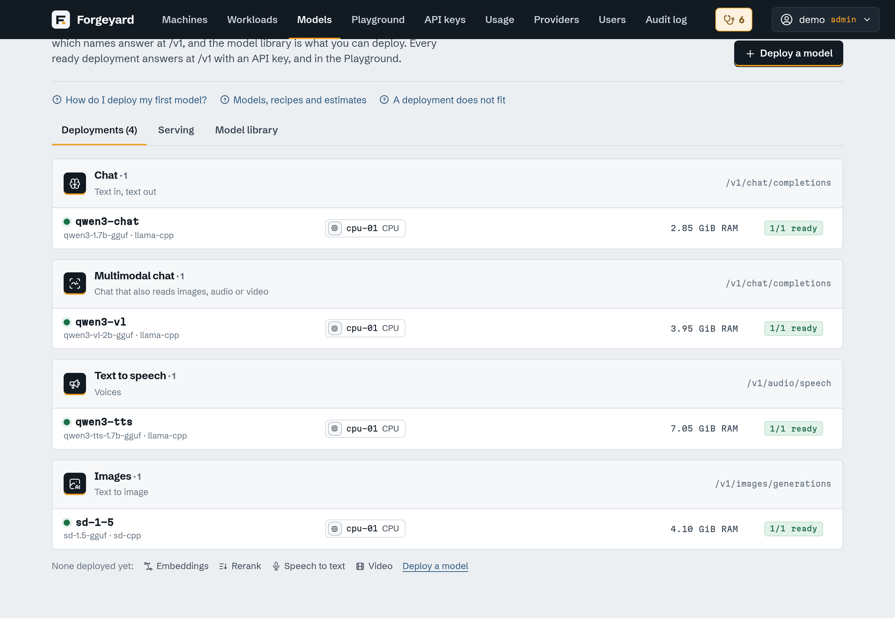

# Forgeyard

[](LICENSE)
[](https://github.com/xianhong1208/forgeyard/actions/workflows/ci.yml?query=branch%3Adev)
[](https://github.com/xianhong1208/forgeyard/releases/latest)
[](https://hub.docker.com/r/tonyhuang1101/forgeyard)

在你自己的 NVIDIA、AMD 與 CPU 機器上執行 AI 模型，統一走一個 OpenAI 相容的 API。

每台機器上的 agent 回報它的硬體。你從模型目錄部署模型，Forgeyard 把它放到放得下的機器上，任何程式都能用 API
金鑰在 `/v1` 呼叫它。

**[使用指南](docs/guide/zh-TW/README.md)** · **[English](README.md)** · **[發展藍圖](ROADMAP.zh-TW.md)** ·
**[變更紀錄](CHANGELOG.md)**（英文）



## ✨ 主要功能

- **一個控制台管理 NVIDIA、AMD 與 CPU 機器。** 每台機器在你允許的顯示卡上執行模型副本、服務與任務；AMD
  顯示卡使用 ROCm 或 Vulkan 版本。每台機器的頁面會畫出每張卡的記憶體分別被哪些部署和工作負載佔用，並列出快取裡的模型和大小，可刪除那台機器上沒有部署在用的模型。
- **部署前先估算記憶體。** Forgeyard 不用下載模型就能讀到它的資訊，顯示一份副本需要多少記憶體、放得進哪些機器，小模型還能共用一張 GPU。
- **OpenAI 相容的閘道。** 每個部署都在 `/v1` 提供服務，有 API 金鑰、每個金鑰的限制、依金鑰、模型和人統計的用量與費用（可按日、週、月畫成折線圖），副本之間會自動容錯移轉。
- **本機優先，必要時才用雲端。** 只有本機副本忙碌或停擺時，而且只限允許的金鑰，請求才會在每月預算內溢出到
  OpenAI、Anthropic、Gemini、Azure 或 OpenRouter。
- **不只是對話。** 對話中的圖片、音訊與影片、embedding 與 rerank、語音轉文字、文字轉語音、圖片生成，以及以非同步工作產生的影片。
- **任何 HTTP 服務都能用同一套金鑰。** 工作負載的 API 放在 `/x/<name>/…`，有金鑰、限制與用量；現成的範本一步就能啟動物件偵測、影像分割與深度估計的 API。
- **開箱即用的 HTTPS。** 伺服器自己建立憑證授權單位（CA），agent 加入時釘選它的指紋，儲存的機密都經過加密。
- **沒有網路的機器。** 用檔案帶過去的引擎映像檔，就能照原樣執行內建的 recipe；agent 執行前會先核對載入的映像檔是不是釘選的那一個。放置副本時，會優先選已經有模型和引擎的機器，避開連不到 Hugging Face、GitHub 或映像檔 registry 的機器，並把卡在這種下載上的副本移到連得到的機器。

## 1.3 的新功能

1.3 加入對話中的圖片、音訊與影片、文字轉語音、圖片與影片生成、`/x/` 的工作負載與視覺範本，伺服器與 agent 映像檔也發布到 Docker
Hub。1.3.1 可以直接修改部署；1.3.2 與 1.3.3 是修正版。所有變更見 [CHANGELOG](CHANGELOG.md)（英文）。

## 🚀 安裝

### 伺服器

伺服器不需要 GPU。用 Docker（linux/amd64 與 linux/arm64，什麼都不用建置）：

```bash
sudo docker run -d --name forgeyard --restart always --hostname forgeyard \
  -p 7860:7860 \
  -v forgeyard-data:/data \
  -e PUBLIC_URL=https://192.168.1.20:7860 \
  docker.io/tonyhuang1101/forgeyard:1.3.3
sudo docker logs forgeyard
```

或從原始碼安裝，需要 [uv](https://docs.astral.sh/uv/)（它會自己取得 Python 3.13），以及建置網頁 UI 用的 Node 22.12 或更新版本：

```bash
git clone https://github.com/xianhong1208/forgeyard.git
cd forgeyard
cd web && npm ci && npm run build && cd ..
uv sync
HOST=0.0.0.0 PUBLIC_URL=https://192.168.1.20:7860 uv run python main.py
```

把 `192.168.1.20` 換成你伺服器的位址。紀錄裡會有 `https://192.168.1.20:7860/setup` 用的一次性設定權杖。伺服器用自己的憑證授權單位提供
HTTPS，所有資料都放在 `data/`（Docker 則是 `forgeyard-data` volume）。clone 下來的是最新的正式版本；`git checkout dev`
可以取得還沒發布的內容。

### Agent：每台要跑模型的機器

**Machines → Add a machine** 會產生指令。單行安裝會先用指紋核對伺服器的 CA，再把與伺服器同版本的 agent 裝成 systemd 服務：

```bash
curl -fsSk https://192.168.1.20:7860/api/tls/ca.pem -o forgeyard-ca.pem && \
  sed '/-----/d' forgeyard-ca.pem | base64 -d > forgeyard-ca.der && \
  echo "3f9a…  forgeyard-ca.der" | sha256sum -c && \
  curl -fsS --cacert forgeyard-ca.pem https://192.168.1.20:7860/install.sh | \
  sudo sh -s -- --join fyj_… --ca-fingerprint sha256:3f9a…
```

也可以用 **Docker** 分頁產生的 agent 映像檔指令。在 NVIDIA 機器上長得像這樣：

```bash
sudo docker run -d --name forgeyard-agent --restart always --network host \
  --gpus all \
  -v /var/run/docker.sock:/var/run/docker.sock \
  -v forgeyard-agent:/var/lib/forgeyard-agent \
  -v /srv/forgeyard-models:/srv/forgeyard-models \
  -e FORGEYARD_SERVER=https://192.168.1.20:7860 \
  -e FORGEYARD_CA_FINGERPRINT=sha256:3f9a… \
  -e FORGEYARD_JOIN_TOKEN=fyj_… \
  -e FORGEYARD_MODEL_CACHE=/srv/forgeyard-models \
  docker.io/tonyhuang1101/forgeyard-agent:1.3.3
```

加入權杖只能用一次，而且 15 分鐘內有效。AMD 與純 CPU 機器：
[加入 AMD 機器](docs/guide/zh-TW/how-to.md#加入-amd-機器)、
[加入純 CPU 機器](docs/guide/zh-TW/how-to.md#加入純-cpu-機器)、
[用 Docker 執行 agent](docs/guide/zh-TW/how-to.md#用-docker-執行-agent)。

## 快速開始

1. 開啟 `https://192.168.1.20:7860/setup`，輸入設定權杖，建立擁有者。接著開啟 **Trust this server**，在你的裝置上安裝 CA。
2. **Machines → Add a machine**，在機器上執行那行指令。幾秒內它就會出現。
3. **Models → Model library → Add a model**，挑一個推薦的模型（只有 CPU 的話：*Qwen3 1.7B (GGUF, for the CPU)*），再用 **Deploy it** 部署，名稱取為 `qwen`。
4. **API keys → New key**。在要呼叫模型的電腦上取得 CA 檔案和 SDK：

   ```bash
   export FORGEYARD_API_KEY=fyk_…
   curl -fsSk https://192.168.1.20:7860/api/tls/ca.pem -o forgeyard-ca.pem
   pip install openai
   ```

5. 用官方 OpenAI SDK 呼叫它：

   ```python
   import os
   import ssl

   from openai import DefaultHttpxClient, OpenAI

   ca = ssl.create_default_context(cafile="forgeyard-ca.pem")
   client = OpenAI(base_url="https://192.168.1.20:7860/v1", api_key=os.environ["FORGEYARD_API_KEY"],
                   http_client=DefaultHttpxClient(verify=ca))
   reply = client.chat.completions.create(
       model="qwen",
       messages=[{"role": "user", "content": "Say hello in five words. /no_think"}],
       max_tokens=100,
   )
   print(reply.choices[0].message.content)
   ```

使用指南的[快速入門](docs/guide/zh-TW/quick-start.md)會一步一步說明，附上每個指令印出的內容，以及怎麼核對 CA 的指紋。

## 部署方式

| 方式 | 做法 |
|---|---|
| **Docker** | 伺服器與 agent 都在 Docker Hub 上，名稱是 `tonyhuang1101/forgeyard` 與 `tonyhuang1101/forgeyard-agent`，每個版本一個 tag：[用 Docker 執行伺服器](docs/guide/zh-TW/how-to.md#用-docker-執行伺服器)、[用 Docker 執行 agent](docs/guide/zh-TW/how-to.md#用-docker-執行-agent) |
| **systemd** | 單行安裝會把 agent 裝成 `forgeyard-agent` 服務。從原始碼安裝的伺服器也能當成服務執行：[把伺服器當成服務執行](docs/guide/zh-TW/how-to.md#把伺服器當成服務執行) |
| **放在反向代理後面** | 由 nginx 或 Caddy 處理 HTTPS，伺服器以 `TLS=off` 在 `127.0.0.1` 上執行：[使用自己的憑證或反向代理](docs/guide/zh-TW/how-to.md#使用自己的憑證或反向代理) |

升級、備份和搬移模型快取：見[操作指南](docs/guide/zh-TW/how-to.md#升級伺服器和-agent)。

## 📚 文件

**[使用指南](docs/guide/zh-TW/README.md)**（[English](docs/guide/README.md)）也由 Forgeyard 自己在 `/guide` 提供：

| 頁面 | 內容 |
|---|---|
| [快速入門](docs/guide/zh-TW/quick-start.md) | 從零開始，大約十分鐘完成第一次 `/v1` 呼叫 |
| [概念](docs/guide/zh-TW/concepts.md) | 機器與 agent、GPU 存取、工作負載、模型、部署與閘道、金鑰、角色 |
| [操作指南](docs/guide/zh-TW/how-to.md) | AMD 與純 CPU 機器、用 Docker 跑伺服器與 agent、共用 GPU、自己的憑證、升級、備份 |
| [雲端供應商](docs/guide/zh-TW/cloud-providers.md) | 把 OpenAI、Anthropic、Gemini、Azure、OpenRouter 或你自己的伺服器放到 `/v1` 後面；請求何時溢出；哪些金鑰可以使用雲端 |
| [疑難排解](docs/guide/zh-TW/troubleshooting.md) | 在真實機器上遇過的問題與解法 |
| [參考資料](docs/guide/zh-TW/reference.md) | 伺服器與 agent 的所有設定、指令、檔案與連接埠 |

另外：

- [設計說明](docs/design.zh-TW.md)：各部分的運作細節。
- [HTTPS 與信任](docs/https-and-trust.md)（英文）：憑證授權單位、agent 的指紋、加密儲存的機密，以及
  [從 1.0 升級：用一般 HTTP 加入的 agent](docs/https-and-trust.md#upgrading-from-10-agents-that-joined-over-plain-http)。
- [開發](docs/development.zh-TW.md)：建置、測試，以及程式碼結構。

## 已驗證的硬體

每個版本都在真實的機器上檢查過，不只是跑 CI。目前為止：

| 硬體 | 軟體 | 測過的內容 |
|---|---|---|
| NVIDIA A100 80GB PCIe（8 卡主機，使用 GPU 允許清單） | driver 580、CUDA 13.0、Docker | 加入伺服器與 GPU 允許清單；服務和任務以行程或容器執行，各自只看到分配到的顯示卡；vLLM 0.32（Qwen3-4B 對話、Qwen3 embedding 與 reranker、用 Qwen3-VL-2B 在對話中處理圖片與影片、用 Gemma 4 12B 在對話中處理音訊）、speaches 0.8.3（faster-whisper）、vLLM-Omni（Qwen3-TTS 文字轉語音、Stable Diffusion XL 與 Z-Image-Turbo 生成圖片、Wan2.1 生成影片）、llama.cpp 1.0.0 的 CUDA 版本（用 Qwen3-VL-2B 與 Qwen2.5-Omni-3B GGUF 在對話中處理圖片、音訊與影片，用 Qwen3-TTS 1.7B 與 Chatterbox Turbo GGUF 做文字轉語音）；用官方 OpenAI SDK 呼叫閘道；以容器映像檔執行 agent |
| AMD Ryzen AI MAX+ 395 與 Radeon 8060S（Strix Halo，gfx1151 APU，BIOS 切出 96 GiB 給 VRAM） | Ubuntu 24.04、ROCm 7.0.2、amd-smi 26.0.2 | 透過 `amdsmi` 函式庫偵測硬體（統一記憶體）、加入伺服器，並在連不到 Hugging Face 和 `ghcr.io` 的機器上用 llama.cpp 的 Vulkan 版本（在 b12242 上驗收）跑 Qwen3-1.7B GGUF，透過 `/v1` 提供服務；在 llama.cpp 1.0.0 的 Vulkan 版本上（同樣離線）測了對話中的圖片、音訊與影片（Qwen3-VL-2B 與 Qwen2.5-Omni-3B GGUF）以及文字轉語音（Qwen3-TTS 1.7B 與 Chatterbox Turbo GGUF）；用 stable-diffusion.cpp 的 Vulkan 版本生成圖片（Z-Image-Turbo GGUF），映像檔從檔案載入 |
| 沒有 GPU 的 x86-64 | Linux | llama.cpp 1.0.0 以程序執行（Qwen3-1.7B GGUF），同時跑在兩個 agent 上：負載分配，一台的引擎掛掉時自動轉到另一台；用 llama.cpp 在對話中處理圖片、音訊與影片（Qwen3-VL-2B 與 Qwen2.5-Omni-3B GGUF）；llama.cpp 1.0.0（Qwen3-TTS 1.7B GGUF 說中文與英文、Chatterbox Turbo）與 speaches（Kokoro 82M）的文字轉語音，並以 faster-whisper 聽寫確認內容；用 stable-diffusion.cpp 以程序方式生成圖片（Stable Diffusion 1.5 與 Z-Image-Turbo GGUF） |
| Google Gemini（`gemini-2.5-flash`） | 它的 OpenAI 相容端點 | 請求超過本機模型的 context 時溢出到雲端、串流、費用（含思考 tokens）與預算 |

還沒在真實硬體上檢查的：`vllm` 和 `llama-cpp` 配方的 ROCm 映像檔、獨立 AMD 顯示卡，在有 systemd 的主機上用單行指令安裝，以及 Wan2.2-TI2V-5B 的影片生成。影片生成已用 vLLM-Omni 檢查過（A100 上的 Wan2.1-T2V-1.3B，832x480、5 秒）。NVIDIA 上的圖片生成已用 vLLM-Omni（A100 上的 Stable Diffusion XL 與 Z-Image-Turbo）與 stable-diffusion.cpp 的 CUDA 版本（A100 上的 Stable Diffusion 1.5 與 Z-Image-Turbo GGUF）檢查過。歡迎回報在其他機器上的結果（見 [CONTRIBUTING.md](CONTRIBUTING.md)，英文）。

### 實測過的模型

| 模型 | 引擎（配方） | 硬體 |
|---|---|---|
| **對話** | | |
| Qwen3-4B | vLLM 0.32（`vllm`） | NVIDIA A100 |
| Qwen3-1.7B GGUF | llama.cpp（`llama-cpp`） | CPU（1.0.0）；AMD Strix Halo（Vulkan，在 b12242 上驗收） |
| **多模態對話** | | |
| Qwen3-VL-2B Instruct：圖片、影片 | vLLM（`vllm`） | NVIDIA A100 |
| Gemma 4 12B：音訊 | vLLM（`vllm`） | NVIDIA A100 |
| Qwen3-VL-2B GGUF：圖片、影片 | llama.cpp 1.0.0（`llama-cpp`） | CPU；NVIDIA A100（CUDA）；AMD Strix Halo（Vulkan） |
| Qwen2.5-Omni-3B GGUF：圖片、音訊、影片 | llama.cpp 1.0.0（`llama-cpp`） | CPU；NVIDIA A100（CUDA）；AMD Strix Halo（Vulkan） |
| **Embedding 與 rerank** | | |
| Qwen3-Embedding-0.6B、Qwen3-Reranker-0.6B | vLLM pooling（`vllm-pooling`） | NVIDIA A100 |
| **語音轉文字** | | |
| faster-whisper small | speaches 0.8.3（`faster-whisper`） | NVIDIA A100 |
| **文字轉語音** | | |
| Qwen3-TTS 12Hz 0.6B 與 1.7B CustomVoice | vLLM-Omni（`vllm-omni-tts`） | NVIDIA A100 |
| Qwen3-TTS 12Hz 1.7B GGUF、Chatterbox Turbo GGUF | llama.cpp 1.0.0（`llama-cpp`） | CPU；NVIDIA A100（CUDA）；AMD Strix Halo（Vulkan） |
| Kokoro 82M | speaches（`speaches-tts`） | CPU |
| **圖片生成** | | |
| Stable Diffusion XL base 1.0、Z-Image-Turbo | vLLM-Omni（`vllm-omni-image`） | NVIDIA A100 |
| Stable Diffusion 1.5 GGUF | stable-diffusion.cpp（`sd-cpp`） | CPU（行程）；NVIDIA A100（CUDA） |
| Z-Image-Turbo GGUF | stable-diffusion.cpp（`sd-cpp`） | CPU（行程）；AMD Strix Halo（Vulkan）；NVIDIA A100（CUDA） |
| **影片生成** | | |
| Wan2.1-T2V-1.3B | vLLM-Omni（`vllm-omni-video`） | NVIDIA A100 |
| **雲端** | | |
| Google `gemini-2.5-flash` | 它的 OpenAI 相容端點（provider） | — |

## 🤝 參與貢獻

歡迎回報問題、提出想法或送 pull request：請看 [CONTRIBUTING.md](CONTRIBUTING.md)（英文），建置與測試則看
[docs/development.zh-TW.md](docs/development.zh-TW.md)。安全漏洞請依 [SECURITY.md](SECURITY.md)（英文）私下回報；那份文件也說明了
Forgeyard 對網路環境和使用者的假設。

## 📄 授權

[Apache License 2.0](LICENSE)。
